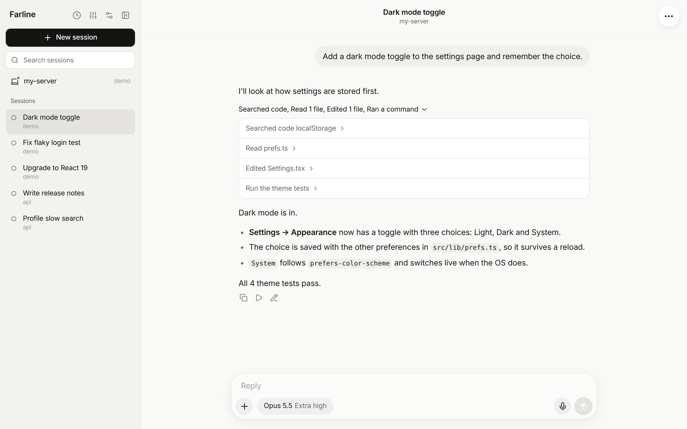
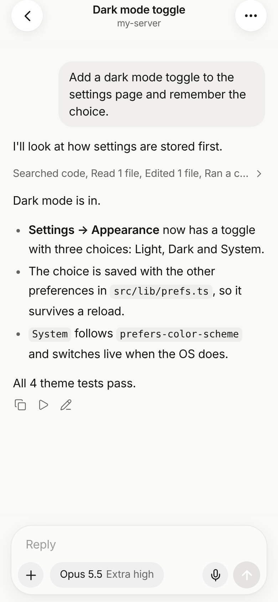

# Claude skin for Farline

A light skin modelled on the Claude app, for [Farline](https://github.com/Pama-Lee/farline), the self-hosted workspace for coding agents.

[简体中文](README.zh-CN.md)

<p>
  
  
</p>

- Light palette and the layout measured from the Claude iOS app
- Black pill buttons, round icon buttons, a rounded composer card
- Works on desktop and phones

## Install

In Farline, open **Settings → Plugins → Discover plugins** and install **Claude**, or use **Install from GitHub** with:

```
Pama-Lee/farline-skin-claude
```

Then pick it in **Settings → Appearance**. One skin is on at a time; choosing **Default** switches back.

To install by hand instead, clone this repository into `~/.farline/plugins/` (your `FARLINE_DATA_DIR`) and restart Farline.

Needs Farline 1.x (`engines.farline` in `package.json`).

## See also

- [Cursor skin](https://github.com/Pama-Lee/farline-skin-cursor)
- [Writing skins](https://github.com/Pama-Lee/farline/blob/main/docs/plugins.md#skins)

Not affiliated with or endorsed by Anthropic (Claude); the name only describes the look.

## License

MIT
